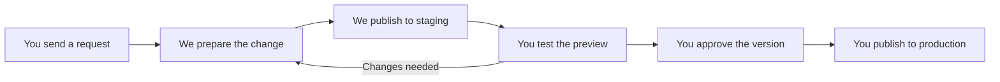

# Update, preview and publish

Fleet Mucky Mayhem | Client and support guide | 21 October 2026

> **Planned workflow, pending setup.** Use this process once the client repositories, branch protection and automated deployments have been configured and rehearsed. Production will be **https://fleetmuckymayhem.com**. The client's staging address and support contact will be added during setup. The existing preview on Martin's account is temporary.

## Who does what?

**You, the client**, request the work, supply the correct content, test the preview, approve the version and merge the release PR to publish it. One named client representative controls the production release.

**We, your support/development team**, agree the work with you, make the changes, run the checks, publish to staging, prepare the release PR and help with publication. We verify the result after you release it. You do not need to run build commands. Your developer can take on more development tasks later with an agreed review process.

**Staging** is the test website. **Production** is the public website. A **pull request (PR)** is a recorded proposal to combine changes. A **merge** accepts it. A **build/deployment** prepares the website and publishes it.

## 1. Your request

Send a message through our agreed support channel. Include the page or section, the exact change, any text/images/links, and when it is needed. Never include passwords. We acknowledge it, agree what is included and any timing or cost, and give it a request reference.

**Example request:** “Please change the Contact Us paragraph to the attached wording. No other changes. Ideally ready for checking on Friday.”

## 2. We prepare and check the change

We work on a separate change branch and open a PR **into `staging`**. We check the content, data, code and build. After the checks and required review pass, we merge it. The configured automation then publishes the test version. A merge alone does not prove publication succeeded.

## 3. We send you a preview

After checking the staging deployment, we message you with the staging link, a short change summary, the request/PR reference, a version identifier and a checklist. We also flag any other changes included in that preview. Staging is publicly accessible, so only supply material suitable for public viewing.

## 4. You test it

Open the link on a phone and a computer. Check the requested content, relevant links/images and the surrounding layout. For ride changes, check dates, times, meeting points and the affected diary/next-ride display. Tell us either what needs correcting or that it is approved.

**Example correction:** “Request FMM-012: the paragraph is right, but the link opens the wrong folder.” We fix it and send a new version for testing.

## 5. You authorise the release

Reply clearly: **“I approve request FMM-012, staging version [identifier], for production.”** Agree a publication time if needed. A request to start work or a successful automated check does not authorise production publication. If the code changes after your test, we send the changed version back for approval.

## 6. You publish the approved version

We prepare a release PR **from `staging` into `main`**, link your approval and check that it contains only the changes you approved. We send you the exact PR link and keep that version fixed for release.

**You open the PR** and confirm it targets `main` and contains the version you tested. If a formal review is required, choose **Files changed**, **Review changes**, **Approve**, then **Submit review**. Once the required checks and reviews pass, choose **Merge pull request**, then **Confirm merge**.

**Your merge into `main` starts the automatic production build and deployment.** You control when the approved change goes live. Keep the permanent `main` and `staging` branches. If GitHub blocks the merge or shows a failure, contact us rather than bypassing the checks. GitHub's [merge guide](https://docs.github.com/en/pull-requests/how-tos/merge-and-close-pull-requests/merging-a-pull-request) explains the controls.

Open the **Actions** tab to follow the production deployment, then message us with the release PR link so we can verify it. Merging starts publication; a successful deployment and live check confirm completion.

## 7. We verify and close the request

We confirm deployment success, open **https://fleetmuckymayhem.com** and check the requested change and key links. We send you the live link, release PR/version and completion time. You make a final check. We record the last successful release and bring staging up to date with production where needed.

If a check or deployment fails, we investigate and tell you the status. We only report the work as live after verifying the public website. For a problem after publication, use [Undo a release](undo-release.md).

## Before this process starts

We will record the client source repository link, staging URL, support channel/contact and named release approver; configure the two branches and publishing destinations; and rehearse a release and an undo. IONOS DNS setup is a launch task, not part of each routine update. Passwords and recovery codes stay outside the public repository.
